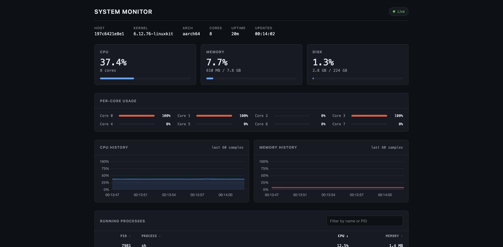
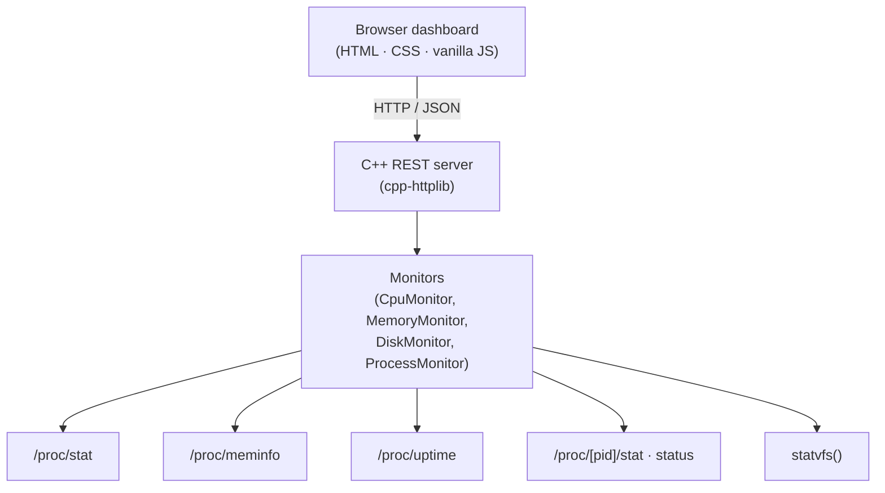

# System Monitor

A lightweight Linux system monitoring dashboard powered by a C++ REST API.



The server reads metrics straight from `/proc` and `statvfs()`, serves them as
JSON, and hosts a dependency-free dashboard from the same port. No agent, no
database, no framework.

## Features

- Live CPU usage, overall and per core
- Memory and root filesystem usage
- The 50 busiest processes with PID, name, CPU share and resident memory
- Client-side process search and sortable columns
- Rolling 60-sample CPU and memory history charts
- System uptime, hostname, kernel version and architecture
- Survives processes appearing and disappearing mid-scan, and the dashboard
  keeps its last values if the server goes away

## Architecture



The same process serves both the API and the static dashboard, so there is no
CORS configuration and nothing to deploy separately.

`SystemMonitor` composes the four monitors. `CpuMonitor` and `ProcessMonitor`
hold the previous sample and guard it with their own `std::mutex`, because
cpp-httplib handles requests on a thread pool. Every parser is a pure function
taking file contents as a string, which is what makes the test suite possible
without mocking a filesystem.

## Technology stack

| Layer | Choice |
|---|---|
| Language | C++17 |
| Build | CMake 3.16+, dependencies via `FetchContent` |
| HTTP | [cpp-httplib](https://github.com/yhirose/cpp-httplib) 0.18.3 |
| JSON | [nlohmann/json](https://github.com/nlohmann/json) 3.11.3 |
| Tests | [doctest](https://github.com/doctest/doctest) 2.4.11 |
| Client | HTML, CSS, vanilla JS, Chart.js 4 from a CDN |

Nothing needs to be installed by hand: CMake fetches the three C++ dependencies
at configure time.

## API endpoints

| Endpoint | Returns |
|---|---|
| `GET /api/health` | `{"status":"ok"}` |
| `GET /api/cpu` | Overall and per-core CPU usage, core count |
| `GET /api/memory` | Total, used and available bytes |
| `GET /api/disk` | Root filesystem total, used and free bytes |
| `GET /api/processes` | Busiest processes, `?limit=N` (default 50, max 500) |
| `GET /api/system` | Everything above except processes, in one request |

A metric that cannot be read returns `503` with an `error` field rather than
inventing a number. In `/api/system` an unavailable section is `null` so one
failing metric does not take down the rest.

```console
$ curl -s localhost:8080/api/system
{
  "cpu": {"usagePercent": 37.4, "coreCount": 8, "perCoreUsagePercent": [100.0, 100.0, 0.0, 100.0, 0.0, 0.0, 0.0, 0.0]},
  "memory": {"totalBytes": 8321798144, "usedBytes": 639602688, "availableBytes": 7682195456, "usagePercent": 7.7},
  "disk": {"totalBytes": 240120725504, "usedBytes": 3010912256, "freeBytes": 224837754880, "usagePercent": 1.3},
  "host": {"hostname": "workstation", "kernelVersion": "6.12.76", "architecture": "x86_64"},
  "uptimeSeconds": 274920
}

$ curl -s 'localhost:8080/api/processes?limit=2'
[
  {"pid": 4812, "name": "chrome", "cpuPercent": 14.2, "memoryBytes": 832149504},
  {"pid": 921,  "name": "code",   "cpuPercent": 8.1,  "memoryBytes": 521142272}
]
```

## Build

Requires a C++17 compiler, CMake 3.16 or newer, and an internet connection on
the first configure so dependencies can be fetched.

```bash
git clone https://github.com/abdullah-mohsin1/system-monitor.git
cd system-monitor
mkdir build && cd build
cmake ..
cmake --build .
./system_monitor
```

```text
System Monitor running on http://localhost:8080
```

Open <http://localhost:8080>.

### Options

```text
--port N            port to listen on (default 8080)
--client-dir PATH   where the dashboard files live (auto-detected)
```

### Tests

```bash
cd build
ctest --output-on-failure
```

### Developing on macOS or Windows

There is no `/proc` outside Linux, so the server only reports real numbers
there. `Dockerfile.dev` exists purely to build and run the Linux target from
another host:

```bash
docker build -f Dockerfile.dev -t sysmon-dev .
docker run --rm -p 8080:8080 --pid=host sysmon-dev
```

`--pid=host` lets the container see the host's process table instead of its
own. Note that disk figures still describe the container's filesystem.

## Project structure

```text
system-monitor/
├── CMakeLists.txt          fetches dependencies, builds lib + server + tests
├── Dockerfile.dev          Linux build/run environment for non-Linux hosts
├── include/                one header per monitor, plus the /proc file helper
├── src/
│   ├── main.cpp            routes, JSON serialisation, static file hosting
│   ├── SystemMonitor.cpp   composes the monitors, uptime and host metadata
│   ├── CpuMonitor.cpp      /proc/stat
│   ├── MemoryMonitor.cpp   /proc/meminfo
│   ├── DiskMonitor.cpp     statvfs()
│   ├── ProcessMonitor.cpp  /proc/[pid]
│   └── ProcFs.cpp          reads /proc files, which report a size of zero
├── client/                 index.html, styles.css, app.js
└── tests/                  parsing and calculation tests
```

## How CPU monitoring works

`/proc/stat` reports *cumulative* time since boot, in jiffies:

```text
cpu  123456 789 45678 9876543 1234 0 567 0 0 0
     user   nice system idle  iowait irq softirq steal guest guest_nice
```

Those counters only become a percentage when compared against an earlier
reading, so `CpuMonitor` keeps the previous snapshot and computes:

```text
idle  = idle + iowait
total = user + nice + system + idle + iowait + irq + softirq + steal

usage% = (1 - Δidle / Δtotal) × 100
```

Two details are easy to get wrong:

- **`guest` and `guest_nice` are excluded.** The kernel already counts them
  inside `user` and `nice`; adding them again inflates the total on a VM.
- **The result is clamped and guarded.** If `Δtotal` is zero, or the counters
  moved backwards after a suspend, the previous reading is kept rather than
  dividing by zero.

A baseline snapshot is taken when the server starts, so the first request
reports the average since start-up and every request after that covers the gap
since the previous one. Requests arriving less than 50 ms apart reuse the last
result, because a delta of two jiffies is noise.

Per-core usage is the same calculation applied to each `cpuN` line.

### Per-process CPU

Each process's `utime` and `stime` (fields 14 and 15 of `/proc/[pid]/stat`) are
compared against the same system-wide total:

```text
cpu% = Δ(utime + stime) / Δ(total system jiffies) × 100
```

This is a share of the **whole machine**, so on an 8-core box a process pinning
one core reads 12.5%, and the process figures roughly add up to the headline
CPU number. `top` normalises per core instead and would show 100% for the same
process — neither is wrong, but the dashboard is more coherent this way.

Two things make this robust on a live system:

- **Process names are read from the last `)`.** `comm` is parenthesised and may
  itself contain spaces and parentheses, so `((sd-pam))` breaks any parser that
  splits on whitespace.
- **`starttime` (field 22) guards against PID reuse.** If a PID reappears with
  a different start time it is a different process, so the old counter is
  discarded and the process reports 0% for one cycle instead of a spike.

Processes that exit between the directory listing and the read are skipped.
That is normal, not an error.

## Known limitations

- Linux only. The monitor classes are separated per metric so a platform
  backend could be added, but no Windows or macOS implementation exists.
- Disk usage covers the root filesystem only.
- CPU percentages are computed between consecutive requests, so a client that
  polls irregularly gets figures over irregular windows.
- History is kept in the browser. Reloading the page clears the charts; nothing
  is persisted.
- Anyone who can reach the port can read the process list. There is no
  authentication, so bind it to a trusted network only.
- Inside a container `/proc` is namespaced, so the process list and host
  metadata describe the container unless it runs with `--pid=host`.
- Chart.js loads from a CDN; without internet the dashboard drops the charts
  and keeps everything else.

## Future improvements

- Network interface throughput from `/proc/net/dev`
- Multiple mount points instead of just `/`
- Per-process command line and owner from `/proc/[pid]/cmdline` and `status`
- A background sampler on a fixed interval, so CPU figures no longer depend on
  client polling cadence
- Optional server-side history with a configurable retention window

## Licence

MIT — see [LICENSE](LICENSE).
